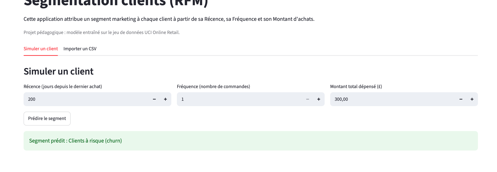
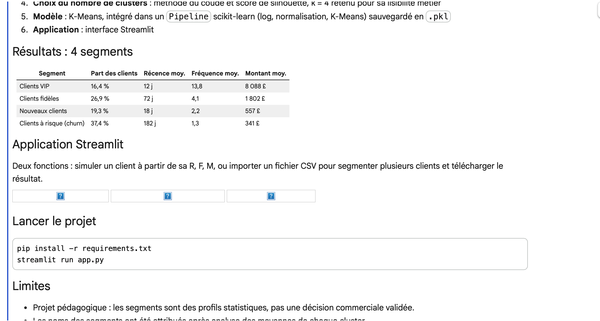

# Segmentation clients par RFM

Projet pédagogique de Machine Learning non supervisé : regrouper les clients d'une boutique en ligne selon leur comportement d'achat, afin de personnaliser les actions marketing.

## Problème métier

Une entreprise e-commerce veut savoir qui sont ses meilleurs clients, lesquels risquent de partir et lesquels viennent d'arriver, pour adapter ses offres. Ce projet segmente les clients avec la méthode RFM :

- **Récence (R)** : nombre de jours depuis le dernier achat
- **Fréquence (F)** : nombre de commandes
- **Montant (M)** : total dépensé

## Données

- Jeu de données : **Online Retail** (UCI Machine Learning Repository)
- Transactions d'une boutique en ligne britannique entre décembre 2010 et décembre 2011
- 541 909 lignes brutes, 392 692 lignes après nettoyage, **4 338 clients**
- Les données ne sont pas incluses dans ce dépôt : [lien de téléchargement](https://archive.ics.uci.edu/dataset/352/online+retail)

## Méthodologie

1. **Nettoyage** : suppression des lignes sans identifiant client, des annulations de facture, des quantités et prix négatifs ou nuls, et des doublons
2. **Calcul RFM** : une ligne par client
3. **Transformation** : logarithme (`log1p`) pour réduire l'asymétrie, puis `StandardScaler`
4. **Choix du nombre de clusters** : méthode du coude et score de silhouette, k = 4 retenu pour sa lisibilité métier
5. **Modèle** : K-Means, intégré dans un `Pipeline` scikit-learn (log, normalisation, K-Means) sauvegardé en `.pkl`
6. **Application** : interface Streamlit

## Résultats : 4 segments

| Segment | Part des clients | Récence moy. | Fréquence moy. | Montant moy. |
|---|---|---|---|---|
| Clients VIP | 16,4 % | 12 j | 13,8 | 8 088 £ |
| Clients fidèles | 26,9 % | 72 j | 4,1 | 1 802 £ |
| Nouveaux clients | 19,3 % | 18 j | 2,2 | 557 £ |
| Clients à risque (churn) | 37,4 % | 182 j | 1,3 | 341 £ |

## Application Streamlit

Deux fonctions : simuler un client à partir de sa R, F, M, ou importer un fichier CSV pour segmenter plusieurs clients et télécharger le résultat.



## Lancer le projet

```bash
pip install -r requirements.txt
streamlit run app.py
```

## Limites

- Projet pédagogique : les segments sont des profils statistiques, pas une décision commerciale validée.
- Les noms des segments ont été attribués après analyse des moyennes de chaque cluster.
- Un achat exceptionnel isolé (par exemple un client avec une seule commande très élevée) peut être classé dans un segment qui ne reflète pas son vrai comportement.
- Le modèle est entraîné sur une seule année de données d'une entreprise britannique.
- Le fichier `.pkl` doit être chargé avec la même version de scikit-learn (1.6.1).

## Auteure

Khadidiatou Lucia Sy Hodonou
